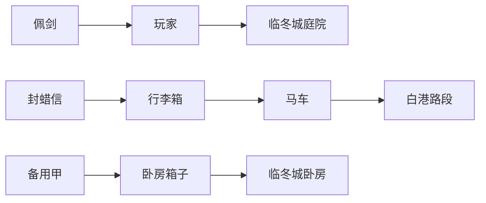

# 人物、地点、装备及关联状态如何保持一致

状态：地点、场景、物品保管、装备和授权的核心关联已接入运行时；扩展边界见 [实施状态](../IMPLEMENTATION_STATUS.md)。关联不应靠各面板互相同步字符串；同一实体只保留一份当前权威状态，各系统用稳定 ID 引用，再按具体关系推导结果。

## 1. 当前已有的基础与缺口

[worldRuntimeTypes.ts](../../../src/features/world/worldRuntimeTypes.ts) 已区分资产的 lawfulOwner、controller、custodian、placement、equippedPosition；[worldProjection.ts](../../../src/features/world/worldProjection.ts) 的 `resolveAssetMapLocation` 可以沿人物或资产容器递归得到地图地点，并拒绝容器循环。这是正确的基础，不必推倒重建。

[worldTravelRules.ts](../../../src/features/world/worldTravelRules.ts) 会把人物、同行者、载具、日期与旅程组织成同一世界事务；[worldSelectors.ts](../../../src/features/world/worldSelectors.ts) 提供人物资产、地点等视图。应继续沿用原子事务和派生查询。

目前仍有几种表示同时参与：玩家 ItemSystemState、NPC 的 CharacterItemRecord 及人物事件、世界资产覆盖和旧 lord 展示字段。多种表示本身不必然错误，但必须固定谁有权结算、谁仅为兼容投影；不能各自独立批准同一次穿戴或移动。[仓库专项](storage-equipment.md) 已复现了两条规则链的冲突。

当前 [worldLocation.ts](../../../src/domain/worldLocation.ts) 只有 locationId 与可选 sceneLocation 文本。同地图地点与同一可接触场景需要进一步拆分；“庭院”“上锁卧房”不能仅靠自由文本或相同城市 ID 决定取物权限。

## 2. 五种关系，各自解决不同问题

| 关系 | 回答的问题 | 例子 | 不能推出的结论 |
|---|---|---|---|
| 物理位置/包含 | 实体在哪里、放在什么里面 | 药品在药袋，药袋在马车 | 不证明它归车主所有 |
| 所有权 | 谁拥有合法产权 | 借给伙伴的剑仍归玩家 | 不证明玩家能隔空取用 |
| 保管与控制 | 谁正在保管、谁能实际处置 | 店主代存玩家箱子；盗贼占有失物 | 不自动获得出售/赠与权 |
| 授权 | 在什么条件下可做什么 | 侍从获准取甲，但不能出售 | 不等于所有物品永久共享 |
| 信息认知 | 谁知道哪些事实、何时获知 | 玩家只知道箱子五日前还在旅店 | 不提供实时位置追踪 |

人物之间的效忠、婚姻、同行与雇佣属于社会关系/协议。它们可以形成授权依据，却不会自动共享背包、秘密或位置。模型不能根据“他是我的下属”直接挪走他身上的所有物件。

## 3. 位置通过归属路径推导

下图是拟议物理位置关系，箭头表示“当前位于”，不代表产权或授权：

玩家走到大厅，只改变玩家当前的位置锚点；佩剑仍挂在玩家身上，自然随行。马车前进，只改变载具锚点，箱子和信件的位置沿包含路径更新。卧房里的甲留在原处，即使它归玩家所有。

每个有物理形态的实体同一时点只有一个直接位置父节点。地图地点、稳定场景节点和旅途中的路段构成位置锚点；人物/容器/载具可作为符合类型规则的父节点。禁止循环、无效父节点或“同一件东西同时在两个人身上”。容器嵌套按玩法限制合理深度，不引入任意无限套娃。

人物可以处于车船中，因此人物位置也需要引用载具或旅途锚点；既有平面 locationId 保留为派生的地图兼容字段。骑乘按专门关系表达，不能同时让马跟随人物、人物又位于马内而构成循环。

同行队伍记录成员、出发同意/职责、路线和分队情况。关系名单不代替物理位置：仍在旅店的伙伴不会因为在 partyIds 中就自动登上马车。出发验证谁已到集合点、谁上车、谁留下；只有实际参与者进入本次旅程。

未确定位置与“别人不知道他在哪”分开：前者是世界数据尚未确定，后者是观察者认知。失物真实位置已知于引擎时可继续存在；玩家面板仍只显示最后看到的地方。

## 4. 哪些状态存一份，哪些计算出来

| 事实/视图 | 权威持有者 | 读取规则 |
|---|---|---|
| 人物存亡、身体、当前位置锚点 | 人物领域状态与已提交事件 | NPC 与玩家共用同一规则，不凭正文改写 |
| 物品数量、状态、直接位置、使用姿态 | 物品领域状态与交接/使用事件 | NPC 背包与玩家背包都查询同一物品账本 |
| 仓储空间与进入条件 | 场所/容器状态与权限事件 | 地点拥有者、租住者、保管者可以不同 |
| 头衔、岗位、组织预算 | 制度与组织状态 | 不能从人物名字或领地位置猜个人产权 |
| 旅程、成员与路线进度 | 旅程状态及出发/分队/抵达事件 | 按模拟时间更新，不按聊天轮数推进 |
| 某人物当前装备列表 | 派生视图 | 从实际穿戴/持用的物品查得，不另存可独立修改的列表 |
| 物品实际地图位置 | 派生视图 | 沿直接位置关系找到地图/场景/旅途锚点 |
| 人物总负担、能力修正、防护 | 统一规则解释器的派生值 | 身体、穿戴、携带与当前行为条件共同决定 |
| 面板、地图标签、正文角色卡 | 观察者可见投影 | 在相同世界修订号上按各自认知过滤 |

事件保存变化证据，当前状态是对应分支与版本的投影/快照。不能让日志、快照和模型摘要各自成为可互相覆盖的真相。原作资料只提供对应开局基线；已发生动态事件优先。

每个派生字段都标明依赖与版本。例如护甲修正依赖物品状态、穿戴姿态、覆盖部位、身体限制和攻击条件；只更换衣服无需重算所有人的家谱。容器移动后不逐件写入所有子物品坐标，只失效相关位置视图。

## 5. 装备与人物如何相连

装备使用姿态至少区分穿着、持用、收起；普通存放不是装备姿态。引用同一个 itemId，不能把“人物装备栏里的剑”和“世界资产里的剑”当成两件东西。

穿戴/持用物件必须位于对应人物的直接控制范围；放进仓库或交给另一个人时，旧装备状态在同一事务解除。藏在行李箱内的甲不能继续提供防护。佩剑收鞘仍随身，但不占用持剑的双手。

人物被缴械：同一结果解除持用、改变物理位置/保管、移除相应效果并生成事件；不会因为法理所有权没变就继续获得加成。

人物负担与容器容量分别计算。包能整理物品但不能消除实际重量/笨重；装备在身也有负担。递归计算时每件物品只算一次，不能把箱内物品既算进箱重又再次独立累加。数值尺度需要专项校准，不直接假定现有容量单位就是重量。

穿戴限制、破损、药物消耗、伤势和工具用途沿同一规则链执行。用于治疗的绷带必须实际能取到，并绑定目标伤势；治疗结果、材料消耗与耗时属于同一次提交。

## 6. 一次行动如何更新所有关联

以“从自己的箱子取甲换装，把旧衣放回去”为例：

1. 锁定当前周目、分支、世界修订号和本次请求 ID。
2. 解析实际场景、箱子进入条件、取物权限、甲与旧衣的位置和状态。
3. 计划取出、卸下、存放与穿戴的顺序，验证容量、部位、时间与协助条件。
4. 在内存事务视图应用全部变化，验证最终状态及必要中间步骤；不允许穿过锁闭障碍或在需要腾手的步骤凭空忽略物理条件。
5. 从这份一致视图生成允许表现的结果和正文；不得混用修改前人物与修改后物品。
6. 原子提交相关状态、事件、必要认知及派生任务标记；刷新受影响的面板/地图/效果视图。

其中任何必需步骤失败，整组不提交。若玩家先明确同意“取到甲后再决定是否换装”，则那是两次有意分开的行动，不能用技术失败偶然制造半完成状态。

UI、自然语言和后台 NPC 行为使用同一计划器。预检结果带版本，正式提交重验；不能 UI 只看距离、模型只看叙述、后台只看时间，各自拥有不同权限规则。

NPC 后台先拿走箱中唯一物品时，玩家旧页面上的换装计划应刷新或被有依据地拒绝。事务幂等防止网络重试再取一次；取消不留下半件装备，重新生成正文不重做已提交交接。

## 7. 常见事件的连带结果

| 触发 | 一起变化的内容 | 不自动发生的内容 |
|---|---|---|
| 人物旅行 | 人物/实际同行者/参与载具的锚点与旅程；附着物品位置随之派生 | 私人仓库、所有好友、远方部下不跟着走 |
| 登船/下船 | 人物与实际携带物品的包含关系、船载容量、出入事件 | 不自动装上所有拥有的货物 |
| 借出武器 | 保管和位置、借还义务、装备状态 | 法理所有权不变；双方不自动共享使用效果 |
| 正式赠与 | 对方接受且交割后变更所有权/保管/位置，解除旧使用状态 | 关系好感不保证增加，也不默认答应附带请求 |
| 被俘 | 身体/行动受限、拘押位置、实际被收缴物品的去向 | 不删除全部背包，不自动夺走远方全部产业 |
| 死亡 | 生命状态、遗体与附着物品处理、需要中止/转交的事务、继承案件 | 资产不瞬移给继承人；未获知者不立刻收到死讯 |
| 城堡易主 | 控制权、岗位和进入条件按事件变化，相关任务重新校验 | 不默认改写每只私人箱子的产权 |
| 载具损坏/失窃 | 载具能力、旅程可继续条件、货物实际处境与已知消息 | 不凭“船沉了”一律删除未判定毁损的全部物品 |
| 分队或伙伴离开 | 队伍协议、实际成员、交接任务与位置关系 | 伙伴持有的东西不自动归还或传送到玩家 |

生死、被俘、继承、船难等不是无脑级联删除。每种领域事件定义需要检查的关联；能证明的状态才变更，未决事项显式保留。

## 8. 大量 NPC 的装备如何避免复制和膨胀

保留稳定模板与按需实例化。现有 [characterItems.ts](../../../src/features/characters/characterItems.ts) 已按人物和模板 slot 生成稳定 baseline 实例 ID，并由事件叠加转出/丢失，这是可沿用的方向。

特殊物件、实际交接、损坏、遗失或参与关键行为后必须有持久化实例。背景衣物可以保留确定性的模板引用，只有需要时展开完整状态；不能每次打开面板随机生成一套不同装备。

模板展开不代表重新发放。物品曾转出/损坏后保留对应覆盖或移除标记；再次加载 NPC 时必须应用事件，不能因模板仍含“剑”就补发另一把。模板版本固定于周目或通过显式迁移，不能热更新后改变既有装备事实。

玩家接替已有 NPC 视角时，仅改变受控 characterId 和观察者知识，人物与物品实例都保持原 ID；不复制 NPC 装备到一套新的玩家库存。旧架构兼容期可以保留读取适配，但不允许两个存储出口独立写同一件物品。

## 9. 面板、正文与性能

人物面板、行囊、仓库、地图和模型上下文读取同一世界版本；各自再按观察者认知过滤。当前穿戴、可见物件、可取用物资、远方产权分别展示，避免“我的物品”被误解成“现在可用”。

模型只拿本次涉及的依赖集合。例如拜访某人时，给双方、当前场景、相关信物/身份与交涉依据；不拿该人的全部家族库存和全世界资产关系。行动如果需要库房权限，再按 ID 补取必要约束。

建议维护 parent→children、character→已使用物件、principal→产权资产、location/anchor→实体、entity→未完任务、entity→事件等索引。关系图可以继续存于现有本地数据库，无需为了几千人就引入独立图数据库。

缓存按世界版本和依赖版本更新；单个人移动只影响其物理依附子树、相关场景名单、旅程和观察者信息，不重建全世界。权限/知情变化必须使相应视图失效，不能只更新数值而继续展示旧秘密。

## 10. 实施边界与验收

分期顺序：固定实体 ID 与权威写入口 → 统一物品交接计划 → 稳定场景/旅途锚点 → 人物/装备/载具的派生位置 → 接通身体/任务/认知 → 逐步撤下旧双写适配。先实现一条“离家—装车—出行—借物—分队—重逢”的可玩链。

迁移前保留旧存档。生成明确的旧 ID 到新引用映射；NPC 模板物件与已有世界实例去重必须依据来源，不能仅按同名合并。旧地点只有自由文本时保留原描述和未解析标记，不凭猜测创建可取物权限。

必需回归：

- 人物移动后随身物件位置改变，库房物件不变；原地看旧消息的人不自动获知新地点。
- 马车移动后所有层级货物位置正确；无循环、双父节点或重复重量。
- 同场合法取物与换装一步提交；旧物去向明确；失败/取消/重试不丢物不复制。
- 借出佩剑后玩家失去对应效果，伙伴能否使用由其当前状态判定，所有权仍保留。
- NPC 物品转出后重新加载模板不补发；换扮演角色不复制任何实例。
- 被俘/死亡/失去住所分别保持物品真实去向，继承不瞬移；秘密与消息时点正确。
- UI、正文、检定和地图使用同一修订号的可见投影；后台争用资源可重验并拒绝。
- 旧档导入、分支、快照重建后引用可解析，物品总量和产权历史一致。

新增设计与 [大量人物管理](large-cast.md)、[仓库和装备专项](storage-equipment.md)、[上下文事务合同](../roleplay-context-v2/context-memory.md) 一起实施。
