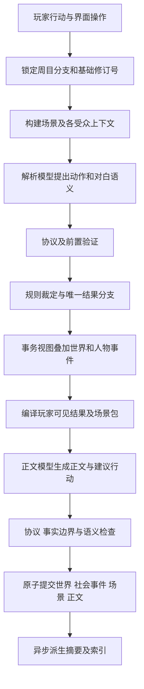

# 上下文、场景与记忆架构

状态：场景、受众过滤、限额召回与承诺账本已经接入默认运行时；更大规模的异步摘要和全局调度仍按本设计的扩展边界暂缓。

大量人物的候选、活动层级、事件调度与人物名单详见 [大量角色管理专项](../gameplay-overhaul-2026-09-07/large-cast.md)，与本篇上下文/认知合同共同实施。

## 1. 明确五种不同的信息

| 信息 | 权威与用途 | 例子 |
|---|---|---|
| 世界事实 | 程序验证并接受的事件与投影 | 戒指被转移；某人已死亡 |
| 人物认知 | 有来源的个人知识、相信的说法、猜测或误解 | 凯特琳知道戒指不见了，但不知道谁拿走 |
| 行动意图 | 玩家或 NPC 尚未被结算的尝试 | 试图拿走戒指；请求保密 |
| 叙事表现 | 事实范围内的文字实现 | 把手收回袖口、停顿、语气 |
| 检索摘要 | 有事件引用、可失效重建的压缩视图 | 上次私谈的焦点与未答复请求 |

世界事实的冲突优先级：本次已验证事务结果 > 同一分支已提交动态状态 > 对应开局的静态基线。旧正文与摘要只帮助回忆，不改写事实。人物认知不与事实合并排序：一个人在世界真相已经明确后仍可以继续相信错误的说法。

原作未来节点属于调度输入；玩家行动文本属于意图与明确发言的证据；NPC 断言属于“有人说了什么”的证据。三者都不能直接升级成世界真相。

## 2. 场景成为上下文组织单位

```ts
// 设计草图；ID、日期等基础类型复用 src/domain。
interface SceneState {
  id: string;
  revision: number;
  locationId: string;
  subLocation: string;                 // 庭院、私室等
  startedAt: SimTime;
  present: PresenceEvidence[];
  communicationSessions: CommunicationSession[];
  currentFocus: string;               // 正在回应的请求/话题
  pendingResponses: PendingResponse[];
  activeCommitmentIds: string[];
  activeConflictIds: string[];
  continuityAnchors: ContinuityAnchor[];
  exitConditions: string[];
}
```

辅助合同含义：`PresenceEvidence` 指人物、进入事件、离开事件/有效区间、可听可见范围；`CommunicationSession` 指通信双方、渠道、消息引用、延迟；`PendingResponse` 指未答复问题/报价、发言者、对象、关联社会事件；`ContinuityAnchor` 是短期物理细节及来源、过期条件；`SimTime` 是世界日期加日内进度。此处不是可直接编译的完整类型声明。

必须分离 `mentionedIds`、`nearbyIds`、`presentIds`、`communicationPartnerIds`。检索到人不代表他在场；同一座城堡不代表能听见密谈；收信人不在寄信瞬间知情。进入与离开场景都是有依据的动作。

候选顺序：本场景实际在场者 → 当前通信对象 → 玩家明确提及对象 → 当前承诺/冲突的参与者 → 相关历史人物。仅对需要本次交互的人提供完整卡，其余只给必要索引或不加载。名字歧义优先用已选择对象、关系、在场证据消歧；仍有歧义时保留“未解析对象”，不能默认挑原作最有名的人并执行不可逆动作。

## 3. 从拼接字符串改为编译上下文包

```ts
interface ContextPacket {
  schemaVersion: 2;
  runId: string;
  branchId: string;
  turnId: string;
  baseRevision: number;
  stage: 'resolution' | 'npc-decision' | 'narration' | 'memory';
  audienceId: string;
  sections: ContextSection[];
  manifest: ContextManifest;
}

interface ContextSection {
  key: string;
  priority: number;
  required: boolean;
  sourceIds: string[];
  audienceScope: string;
  content: unknown;                    // 实现时使用带判别字段的 schema
  measuredTokens?: number;
  estimatedTokens: number;
  truncationPolicy: 'never' | 'entries' | 'summary';
}
```

`ContextManifest` 记录每段来源版本、为什么召回、实际/估计 token、被省略条目及原因、模型角色/提示词版本、包哈希。调试界面能回答“为什么记起这句话”和“为什么不知道那件事”。不保存 API Key，不把隐藏知识暴露给普通游戏界面。

编译顺序固定为：读取事务视图 → 解析玩家引用 → 按受众/时间/分支过滤 → 检索召回 → 消除已失效条目和重复 → 装配必需事实 → 分配可选预算 → schema/边界校验 → 生成 provider 消息。

权限过滤先于语义召回和排序，防止秘密通过摘要、搜索片段、相关度分值或引用标题泄漏。对每个需要模型处理的受众分别编译上下文。

### 3.1 各层内容

| 层 | 常驻/动态 | 核心内容 |
|---|---|---|
| P0 角色合同 | 短常驻 | 该阶段职责、事实权威、玩家自主权、协议 |
| P1 周目锚点 | 小型常驻 | 玩家身份、世界分支、开局履历、文风偏好、术语 |
| P2 当前场景 | 必需 | 位置、时段、在场者、刚说了什么、未回答事项 |
| P3 可行动事实 | 动态 | 相关装备/资源、伤势约束、目标对象与能力白名单 |
| P4 人物卡 | 动态 | 关系依据、可见性格表现、已授权反应范围 |
| P5 近期记录 | 动态 | 最近逐字发言、上一拍末尾、近期已结算事件 |
| P6 长期召回 | 动态 | 承诺、旧事、误解、相关情节与来源 |
| P7 本次工作单 | 必需 | 当前输入；正文阶段为确定的结果与对白语义 |

规则只装配当前相关能力模块：交谈不用加载完整战斗命令与全物品目录。正文不读可执行命令白名单、全部状态或未来排程，而读可叙述结果、受众许可与场景卡。

### 3.2 初始 token 预算

以下是待测起始值，不是任何模型供应商的保证。token 不等于中文字数。

| 角色 | 目标输入 | 输出上限起点 | 重点 |
|---|---:|---:|---|
| 规则解析 | 约 8k tokens | 2.5k tokens | 结构、动作证据、候选结果 |
| 正文 | 约 10k tokens | 3k tokens | 当场对白、关系与历史呼应 |
| 关键 NPC 决策（按需） | 约 3k tokens | 1k tokens | 此 NPC 私有认知与选择空间 |
| 场景摘要（后台按需） | 约 6k tokens | 1.5k tokens | 有来源的压缩，不创造事实 |

正文 10k 目标输入示例分配：合同 0.8k，周目锚点 0.5k，场景 1.2k，人物 1.5k，本回合结果 1.5k，近期发言/正文片段 1.8k，长期召回 1.5k，余量 1.2k。这是分配目标，不强迫填满。

实际输入必须同时满足产品预算与 `contextWindow - outputReserve - providerOverhead - safetyMargin`。未知端点使用显式配置的保守档；有 tokenizer 用实际计数，否则标注估算并按历史 usage 校准，不能用英文“4 字符一 token”直接推算中文。

超预算先移除无关史料、轻量背景卡、已解决普通回忆，再缩减旧正文；保留当前行动、结果、角色身份、在场证据、关键承诺与必要资源。不得半截裁掉 JSON 或随意截断一条誓言。必需内容仍超限时暂停此阶段并明确提示输入过长，不以遗漏约束换取生成。

近期历史不再固定四回合全文。初始策略是最近 1—2 回合的相关逐字发言、上一拍结尾、当前场景摘要和本场景未解决事项；有逐字引用需求时按事件/发言 ID 取原文。长度由预算控制。

## 4. 认知体系：事实、听闻与误解分别维护

```ts
interface KnowledgeRecord {
  id: string;
  holderId: string;
  propositionId: string;
  stance: 'knows' | 'believes' | 'suspects' | 'disbelieves';
  source: {
    eventId: string;
    channel: 'witness' | 'conversation' | 'letter' | 'rumor' | 'inference';
    informantId?: string;
  };
  acquiredAt: SimTime;
  confidenceBand: 'low' | 'medium' | 'high';
  status: 'active' | 'retracted' | 'superseded';
  supersededBy?: string;
}
```

`propositionId` 指向一条命题；命题有独立真假/未确认状态和证据，但个人认知不自动读取真相。`confidenceBand` 是角色相信程度的离散表达，不是统计概率。

例如：戒指在夜间被窃是一个世界事件；主人晨间发现戒指不见是另一个事件；侍卫声称见到某人靠近，是一条发言及接收者的相信/怀疑。即使主人后来知道被偷，也不会自动知道窃贼姓名。

传播必须经过媒介与到达：当面可听见、信件送达、线人报告或公开公告的有效传播范围。公开信息也不是瞬间让所有角色全知；`public` 描述可公开传播的性质，`reach/receivedBy` 描述实际接触范围。

角色秘密不能通过旁白解释泄漏。必要时程序或隔离 NPC 模型读取私有认知，产生“拒绝谈某事、转移话题、提出条件”等行为计划；返回给共同解析器/正文的只包含允许观察的行为，不带秘密理由。每次私有模型调用只读该角色自己的视角，不能给它所有 NPC 的秘密后要求逐人忘记。

## 5. 社会事件补上文字与世界之间的缺口

仅有金币/伤势/移动命令不够表达角色扮演。增加最小社会事件集：

| 事件 | 表示什么 | 不表示什么 |
|---|---|---|
| `speech.recorded` | 某人在特定受众前说了某命题/问题 | 命题为真 |
| `request.made/answered` | 请求提出、拒绝、接受或附条件 | 请求对应行动已完成 |
| `commitment.created/fulfilled/broken` | 有明确条件的义务成立或结算 | 含糊客套自动成誓言 |
| `knowledge.acquired/revised` | 某人经某来源获悉/修正判断 | 所有人同步知情 |
| `relationship.shifted` | 由经历支持的关系增量 | 模型任意重写关系总值 |

首版只做这些事件；情绪作为有期限的角色状态，冲突、谣言网络等复杂扩展在竖切通过后增加。平淡发言可以只存转录，重要请求、承诺和知识变化才升级成玩法事件。

解析器同时提出 `speechActs`：说话者、受众、语义、引用证据/事实、确定性、是否创建承诺。程序验证人物在场/可通信、语义来源和权限，生成 `ApprovedBeat`。正文据此措辞。

这允许 NPC 在正文中说新句子，但句子的玩法含义已被批准。正文不能把“会考虑”扩写成“我发誓照办”，也不能用新台词偷偷泄密。未来确需正文创造新的社会事实时，必须先暂存并重新通过提案/验证阶段；不得正文落盘后再倒推为真。

## 6. 记忆是多种视图，共用事件来源

| 层 | 保存内容 | 更新与召回 |
|---|---|---|
| 原始记录 | 已提交事件、玩家输入、获批准的发言、正文 | 长期保留，按分支可追溯 |
| 工作记忆 | 当前话题、最后一句话、未回应动作、场景锚点 | 每拍更新，离场归档 |
| 情节记忆 | 某次经历及其参与者、结果、代价 | 相关人/地点/诉求出现时召回 |
| 关系记忆 | 救命、羞辱、援助、背约等关系依据 | 见面及关系决策时召回 |
| 承诺与未完事项 | 义务、债务、请求、期限、待验证线索 | 条件/期限/对象触发；可解决 |
| 人物认知 | 已知、相信、怀疑、错误判断与来源 | 按受众与模拟时间检索 |
| 文风短记忆 | 近期重复词、开头模式、意象 | 短窗口过期，不进入角色脑海 |

### 6.1 情节记录最小合同

```ts
interface MemoryEntry {
  id: string;
  runId: string;
  branchId: string;
  sourceEventIds: string[];
  sourceTurnIds: string[];
  ownerId: string;                    // 谁的回忆；共享事件派生不同人视角
  kind: 'episode' | 'relationship' | 'scene-summary';
  entityIds: string[];
  topicKeys: string[];
  occurredAt: SimTime;
  recordedAtRevision: number;
  audienceScope: string;
  statement: string;
  interpretation?: string;            // 主观理解，不是事实
  salience: number;
  status: 'active' | 'resolved' | 'superseded';
  supersededBy?: string;
}
```

记忆引用世界事件，不另造一套拥有物品/死亡事实的权威。模型给出的“重要性”只作排序建议，程序可由重大伤害、履约、利益损失等事件类型赋予下限。所谓重要只代表长期不丢失，不意味着每回合都必须塞入提示词。

### 6.2 写入：确定性先行，压缩异步

同一回合事务内写入：世界事件、社会事件、发言语义/转录、认知变化、承诺、场景状态及确定性的记忆索引任务。`ADD_CHARACTER_MEMORY` 旧接口先适配为带来源的记录，不能无限接受孤立的模型自由文本。

模型摘要只在场景结束或未摘要事件达到预算阈值时运行。输入为已提交且同一受众的事件，输出逐条来源；验证后保存派生摘要。失败继续用原事件和轻量索引，不能阻塞下一次正常行动，也不能让记忆写入失败导致世界结果丢失。

### 6.3 召回：约束优先，相关性随后

1. 限定 run、分支可达历史、当前时间与受众。
2. 当前场景待答问题、本次相关承诺、必要证据与前置条件进入必需集合。
3. 按实体 ID、地点、话题、事件类型检索候选，再做中文词法搜索。初期不依赖向量服务。
4. 候选按实体/议题重合、未解决程度、重要性、时间相关性排序，去重同源摘要。
5. 保留不同来源与结果，防止十条相似闲聊挤掉一次背约；按预算选择完整条目。
6. 若评测显示同义表达召回不足，再在权限分区内增加向量索引并与词法检索融合。向量相似度不能代替权限或真假判断。

可以用可解释的加权排序起步，但权重必须经固定案例集调节；不把一条凭空给出的公式称作最优算法。调试记录分项得分和淘汰原因。

### 6.4 压缩：保留因果与不同声音

摘要保留：谁做了什么、谁看见/听见、在哪儿、结果、未解决事项、准确承诺、分歧与来源。可删除装饰性天气、重复寒暄、已经解决且与当前无关的细节。

按场景、时间段、owner 和受众分区压缩；不同受众不得通过摘要扩大权限。明确的承诺文本与关键口供保留逐字引用索引。摘要不能把“可能”“自称”“指控”抹掉，也不能把时间先后写成因果。

禁止无限“摘要的摘要”拼接。生成章节摘要时回读相应原事件，保存源集合哈希与版本；压缩函数有实际字节/token 上限和零槽位分支。源事件失效后摘要随之失效，底层记录不因压缩被删除。

### 6.5 遗忘与纠错

普通经历随时间降低召回优先级；背约、伤害、重要秘密与未偿债务按条件持续影响。认知被纠正后保留过去为何误解的历史，但当前行动使用最新认知。错误摘要标记 superseded 并重建，禁止偷偷修改原始事件。

## 7. 两次默认调用下的完整回合



规则调度可提前计算 NPC 的合法策略；关键秘密决策可插入独立 `npc-decision` 调用，再返回安全行为计划。不默认添加规划、裁判、导演、文学、评审、记忆六次串行模型请求。

规则解析输出中的共同成本、成功轨、失败轨分别明确。每个轨均包含状态/世界/社会变化，时间也属于该轨或共同成本；程序按依赖分组结算。“付款换剑”是一个原子组，付款失败不能拿剑；独立整理披风可与被拒绝的旅行意图分开结算。

动作已知不可能、前置不满足、或缺关键对象时生成有理由的受阻结果；只有模糊性确实阻止行动，才让游戏提出简短澄清。能完成的不相关部分继续处理。

## 8. 本回合结果包必须足够供正文落笔

`ResolvedBeat` 至少包含：

- 行动目标、采用方法、结果分类、已发生/未发生的具体事情。
- 资源与身体前后差异、耗时、在场与通信变化。
- 经验证的社会事件、对白语义、必须保持的条件/不确定性。
- 仅玩家可见的事实与来源；可表现的 NPC 行为。
- 被拒绝结果及玩家可知的受阻原因。隐藏系统理由不能原样进入正文。
- 场景焦点、待答问题、结束位置、候选可行行动。

不再用“接受 MODIFY_GOLD”作为叙事充分信息，应给“交付三枚金龙，接受者与用途已确认，玩家余额由九变六”。暗处发生且玩家不知道的扣款或资产变化需另定可见表现，不能因 debug 差值可见就写成玩家亲见。

正文可补足光线、普通器物质感、动作幅度、语气和停顿；会成为后续玩法依据的钥匙、密道、证人、毒药症状等属于新事实，需预先通过结果包。普通装饰细节如要在下一拍被指代，可保存为有期限的场景锚点；玩家尝试利用它时再验证物理与资源效力。

## 9. 存档、撤回、失败和重试

以现有 Dexie 原子回合提交为根。新增权威的社会事件/认知/场景状态与世界事件同事务写入；摘要与检索索引为派生表，不要求同一事务完成。新增表须有显式 schema 升级与存档导出/导入合同。

建议新增 `socialEvents`、`sceneSnapshots`、`knowledgeEvents`、`memoryIndexes`、`memorySummaries`、`memoryJobs`；命名可以调整，权威与派生区分不可省略。承诺由社会事件投影，避免再增加一份相互独立的承诺真相。

键至少含 `(runId, branchId, id)`，摘要任务携带源修订号、事件集合哈希与算法版本。导入重铸 runId 时同步重映射引用；不能只替换根对象。新分支只有明确继承的祖先事件可达，之后废弃分支的记忆、索引、异步任务都不可见。

正文生成前在内存创建 `TurnWorkingSet`，覆盖世界和人物本回合事件；不得读取旧数据库投影后标成“提交后状态”。数据库真正提交前，对外称“已结算、待提交”。

重试用稳定 turnId、inputHash、baseRevision、规则版本与骰子记录。正文超时后只重写正文，不能重新掷骰；若刷新后需恢复此能力，可持久化独立的 pending attempt，不进入已提交世界。玩家撤回或取消这个尝试后，attempt 和后台任务都失效。修订号冲突必须重建提案；不把过期结果提交到新的世界。

原子提交成功前流式正文标为预览，不生成永久卷宗链接或记忆。取消与协议失败保留旧世界。正文修复次数有限，仍失败则提供重试/取消；不能静默用模型第二次猜测覆盖第一阶段结果。

## 10. 开局、模式与玩家可见界面

开局先由资料与规则创建玩家身份、初始认知、重要关系和首个 SceneState，再生成开场正文。开场可以提出一个待处理请求，不替玩家接受任务、立誓或选择人生目标。使用与普通回合相同的正文事实约束，不能给开场模型一个无限创造状态的特殊通道。

玩家设置分开控制：叙事人称、篇幅、建议选项数量、骰子显示偏好、规则模式与模型角色配置。隐藏骰子界面不等于隐藏掷骰规则；叙事模式也不能把原本失败轨自动变成成功轨。模式变化只影响后续 attempt，不能修改已经锁定的当前结果。

正文旁的“记事”优先显示玩家已知的承诺、期限、共同经历和待验证线索，允许按人物/地点回看来源。隐性关系数值与 NPC 真正秘密不因打开卷宗就全部可见。调试模式单独标记超出角色认知的信息，不能回流到正常上下文。

玩家可以固定希望系统经常记起的已知事件、纠正姓名指代或补充自己明确的角色目标；固定只提高检索优先级，不改变受众或真实性。修改世界事实属于单独的编辑/沙盒能力，不能借“编辑记忆”悄悄绕过规则。
